# SMC CA Tracker installers

Download the installer from the latest release under **Releases**. CA Tracker checks here for new versions and offers to install them.

## How to set up CA Tracker

This walks you from a fresh install to a working setup: signing in, linking your projects to their
CA folders, making watchlists and connecting an AI for submittal reviews. Everything here can be
changed later, and nothing in it moves or renames a folder.

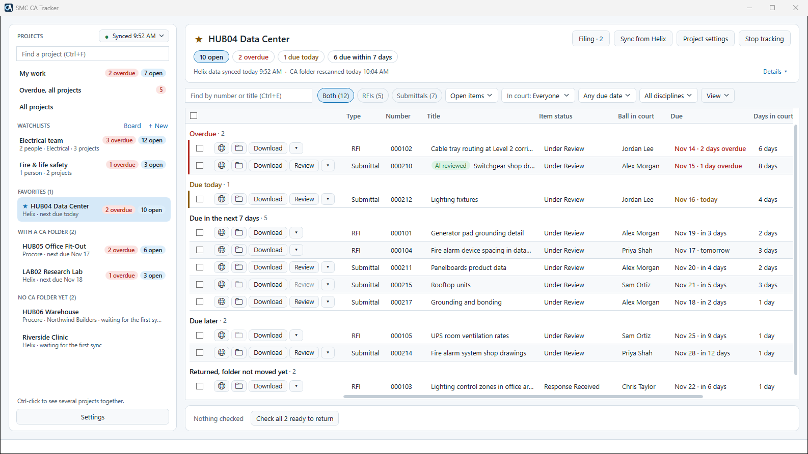

### 1. Install it

1. Download the newest `SMC-CA-Tracker-Setup-<version>.exe` from
   [CA-Tracker-Installer releases](https://github.com/tschnepf/CA-Tracker-Installer/releases/latest).
2. Run it. It installs for your Windows user only (no administrator rights needed) and adds
   **SMC CA Tracker** to the Start menu. The installer isn't code-signed, so if Windows SmartScreen says
   "Windows protected your PC", choose **More info → Run anyway**.
3. Your PC needs to reach the Egnyte drive (or network share) your CA folders are on. CA Tracker's
   built-in browser uses the Microsoft Edge WebView2 Runtime, which comes with Windows 11; the installer
   tells you if it's missing.

CA Tracker updates itself: when a newer version is out, a blue banner offers **Download and install…**.

### 2. First run: the setup guide

The first time CA Tracker opens, a setup guide takes you through four steps. **Skip setup** leaves it;
**Settings → General settings → Run setup again…** brings it back.

**Step 1: Sign in to the ones you use.** Click **Sign in to Helix**, **Sign in to Procore** or both. The
site opens in CA Tracker's own browser window: sign in there once and CA Tracker remembers you. Once
you're in, the card says who you're signed in as and how many projects it found.

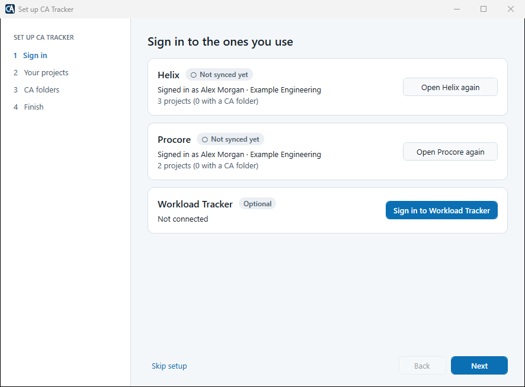

- **Helix:** CA Tracker lists the projects you're assigned to.
- **Procore:** CA Tracker finds every project you can see in every company you belong to, including
  projects hosted by GCs and owners. Nothing has to be installed in anyone's Procore account.
- **Workload Tracker** is optional. Leave it unless your company uses it (see section 7).

**Step 2: Check the projects you work on.** **Find a project** narrows the list. Helix projects (the ones
you're assigned to) start checked; Procore lists every project you can see, so its projects start
unchecked. In this example the Riverside Clinic job was unchecked because Alex doesn't work on it.

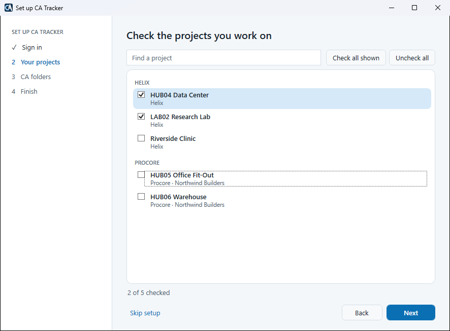

**Step 3: Choose each project's CA folder.** Click **Choose…** and pick the job's CA folder: the one that
holds its `RFIs` and `Submittals` folders. CA Tracker shows what it found inside, so you can tell at a
glance that it's the right folder. Leave a project empty to choose its folder later (LAB02 below).

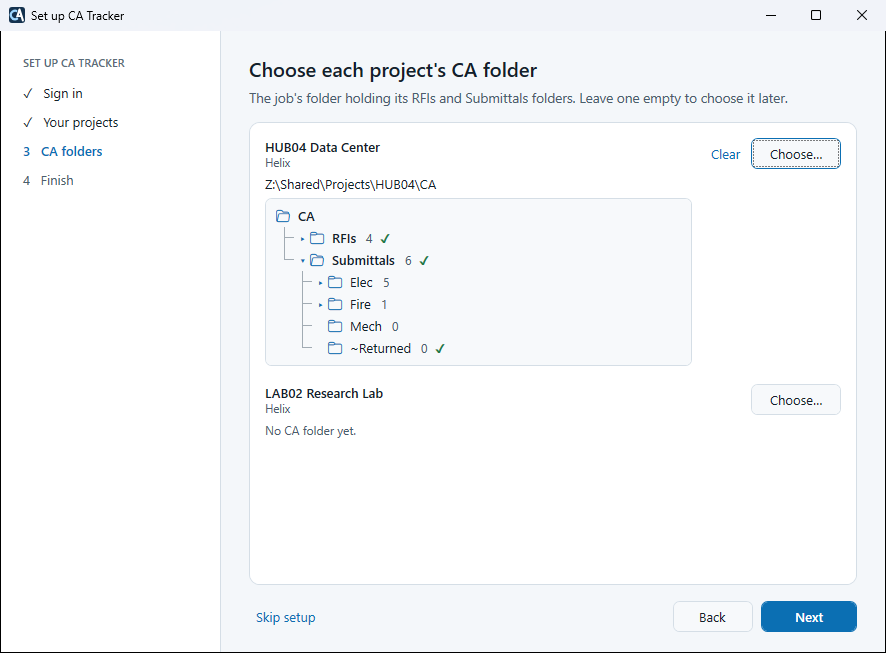

A typical CA folder looks like this. Item folders are named `<number> - <title>`, and may sit in
discipline folders (`Elec`, `Fire`, `Mech`…); returned ones go in `~Returned`:

```text
Z:\Shared\Projects\HUB04\CA                       ← the CA folder you choose
├── RFIs
│   ├── 000101 - Generator pad grounding detail
│   ├── 000102 - Cable tray routing at Level 2 corridor
│   └── ~Returned
│       └── 000106 - Door hardware at loading dock
└── Submittals
    ├── Elec
    │   ├── 000210 - Switchgear shop drawings
    │   └── 000211 - Panelboards product data
    ├── Fire
    │   └── 000214 - Fire alarm system shop drawings
    └── ~Returned
```

If two projects are the two parts of one job and share a CA folder (Base Build and Tenant Fit Out),
click **Two parts of one job…** and say which words in folder names mark each part (for example
`000123 - BB - Lobby lighting` and `000124 - TFO - Suite 200 lighting`).

**Step 4: Finish.** The last page sums up what CA Tracker will do. Projects you didn't check are
*stopped*: hidden from your list and not synced. You can bring any of them back later (see section 3).
Leave **Show me around when I finish** checked for a short tour of the main window, and click
**Finish**. The first sync can take a few minutes; items appear as they arrive.

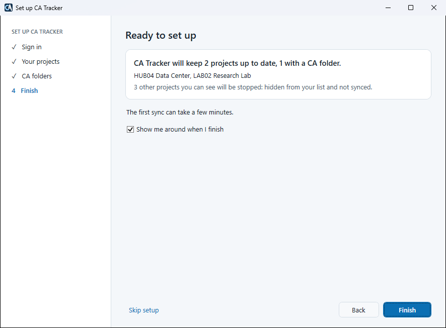

### 3. Link more projects later

New Helix and Procore projects show up by themselves as you're added to them. The project list on the
left has these sections:

- **Favorites:** projects you starred, at the top.
- **With a CA folder:** the projects you track. Each one's items are compared with its CA folder.
- **No CA folder yet:** Helix and Procore projects CA Tracker has found that you haven't set up yet
  (HUB06 Warehouse and Riverside Clinic below).

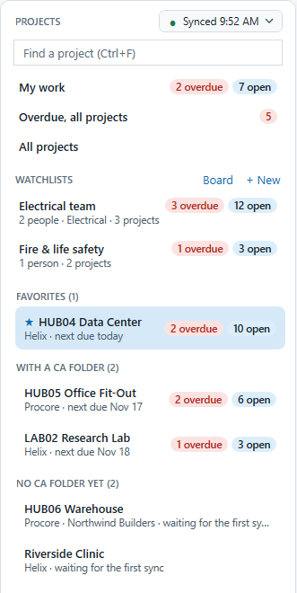

**To set one up:** select it, click **Project settings** (at the top of the window, or right-click the
project), and under **CA folder** click **Browse…**. The project moves up into **With a CA folder**.
Changes in Project settings save as you make them.

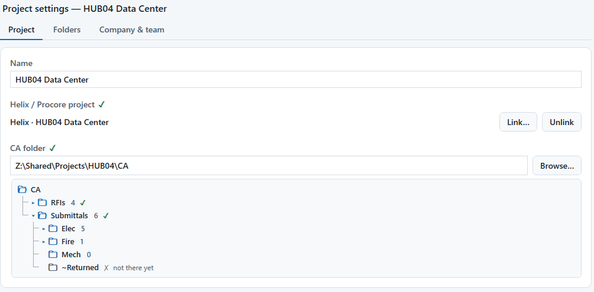

Other cases:

| You want to… | Do this |
|---|---|
| Link a project to its Helix or Procore project | **Project settings → Project → Helix / Procore project → Link…**, then pick it from the list or paste its link. **Unlink** undoes it. |
| Track a job that isn't in Helix or Procore, or the second part of a job | Right-click the project list → **New project from a CA folder…** |
| Split a job into Base Build and Tenant Fit Out | **Project settings → Folders → Base Build / Tenant Fit Out**: choose the part, then check how the two are told apart (by item titles, by folder names, or both). The words each part's names include can be changed. |
| Use different folder names on one project | **Project settings → Folders → Use different folder names for this project**, for example `RFI` instead of `RFIs`. |
| Fix when an item counts as "returned" | **Project settings → Company & team**: make sure **Your company** is right. An item is returned when nobody from that company holds it. |
| Keep a project at the top | Right-click it → **Add to favorites**, or click the star beside its name. |
| Take a project off your list | **Stop tracking** (at the top of the window, or right-click the project). It's hidden and stops syncing, for you only. |
| Bring a stopped project back | Check **Show stopped projects** under the project list, then click **Track again** on it. |
| Give coworkers the same setup | Right-click one or more projects → **Export setup…**. They open the file with **Settings → General settings → Import…**, which shows what will change before anything does. |

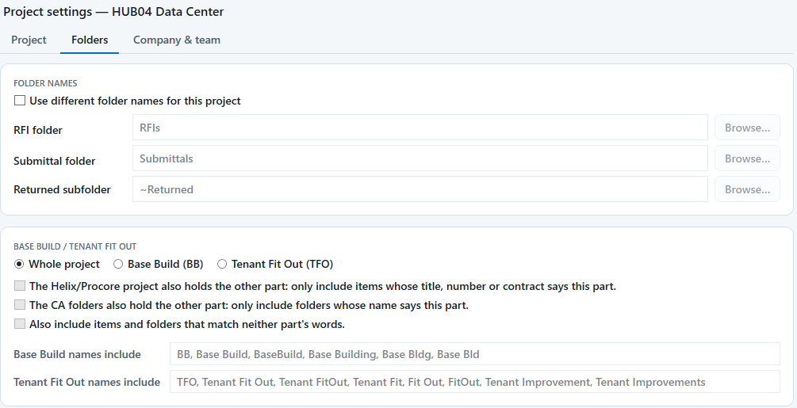

### 4. Day to day

- **My work** (top left): your open items in every project, where the ball is in your court, soonest
  due first. It needs a Helix or Procore sign-in so CA Tracker knows your name.
- **Overdue, all projects** and **All projects**: the same across everyone.
- The list is grouped by when items are due: **Overdue** (red stripe), **Due today** (amber), **Due in
  the next 7 days**, **Due later**, and at the bottom **Returned, folder not moved yet**.
- **Find an item** (Ctrl+E) by number, title or folder name; the filters choose RFIs, Submittals or
  both, open or all items, whose court they're in, when they're due and their discipline.

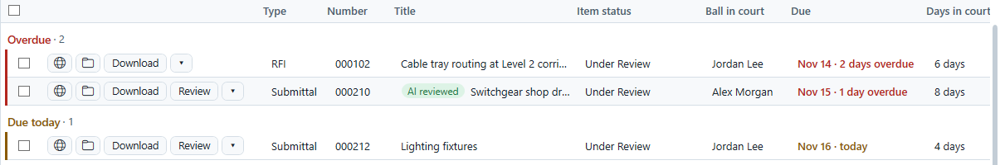

On each row, from the left:

| Button | What it does |
|---|---|
| Globe | Opens the item online (Helix inside CA Tracker, Procore in your web browser). |
| Folder | Opens the item's folder in the CA folder. Greyed out until it has one. |
| **Download** | Saves the item's files into its folder, making the folder if needed (for example `Submittals\Elec\000211 - Panelboards product data`). It shows what it will save first. |
| **Review** | Submittals only: starts an AI review (section 6). Greyed out until the submittal has a folder. |
| **▾** | The rest: show details, open the newest file, verify the folder, set the discipline… |

**Check** several rows and the bar under the list acts on them all: Download, Set discipline, Verify,
and moving folders to `~Returned` and back. Anything that moves a folder shows a preview with **Cancel**
first. **Check all 2 ready to return** (bottom of the first picture) checks the items whose folders can
go to `~Returned`.

**Syncing** is automatic on weekdays (every hour from 7 am to 5 pm, every three hours otherwise). The
**Synced** button at the top of the project list shows when it last ran; click it to sync everything
now, sync one site, or open Connections.

### 5. Make a watchlist

A watchlist follows chosen people, and if you like whole disciplines, across chosen projects. It's
handy for a lead keeping an eye on a team.

**Example:** Alex leads the electrical group. Their "Electrical team" watchlist follows Alex and Jordan
on HUB04 and HUB05, Jordan on LAB02, and every Electrical item on those three jobs whoever holds it.
A second watchlist, "Fire & life safety", follows Priya on HUB04 and LAB02.

1. In the left panel, under the views, click **+ New watchlist** (once you have one, **+ New** beside
   **WATCHLISTS**).
2. **Name** it, for example "Electrical team".
3. **Projects:** check the projects it covers. **Find a project** narrows the list; Shift-click checks
   every project between two.
4. **People:** each checked project gets a column. Check who to follow on each one; under each box is
   what that person holds there now (`1 overdue · 4 open`). **All** under a project checks everyone on
   it, and **All** at the end of a row checks that person on every project (click again to uncheck).
   **Only people from the project's
   company** hides the GC's and other companies' people (anyone already checked stays listed).
5. **Disciplines** (optional): check a discipline to also follow every open item in it on those
   projects, whoever holds it. This adds to the people; it doesn't narrow them.
6. Click **Save**. The line at the bottom sums it up before you do: "Watching 2 people and Electrical
   on 3 projects · 12 open · 3 overdue".

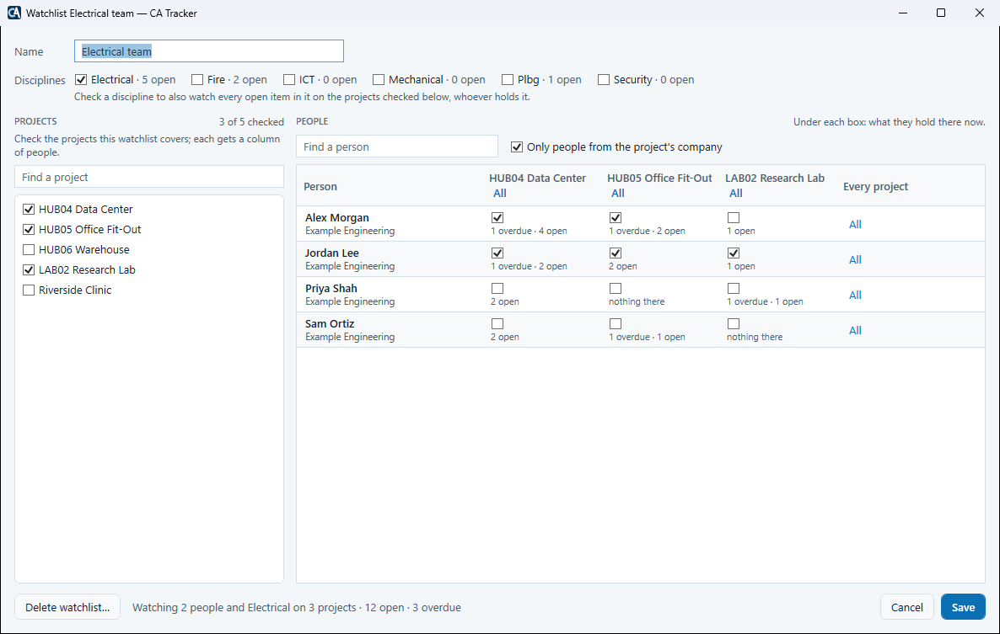

Using it:

- Click the watchlist in the left panel to list the open items its people hold (and any in its
  disciplines), from all its projects together. Its counts show what's overdue and what's open.
- **Board** (beside **WATCHLISTS**) opens the **Team board**: each person (and discipline) by project, with
  overdue and open counts. Click a count to list those items. **Copy as list** copies each person's open
  items as text to paste into an email or a chat. A "—" means the watchlist doesn't follow that person
  on that project.

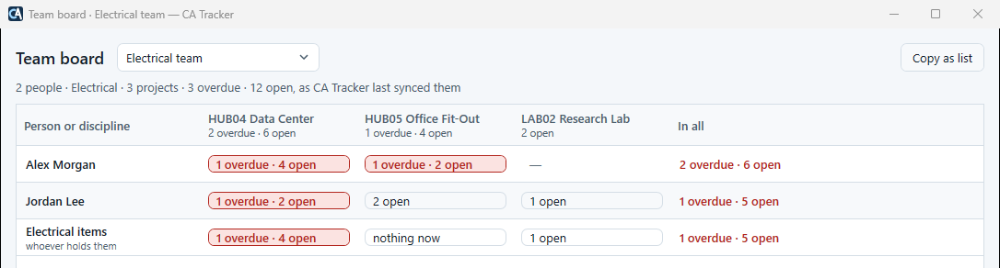

- To change or remove it, right-click it → **Edit…** or **Delete…** (or **Edit watchlist…** /
  **Delete watchlist…** at the top of the window while it's showing). Deleting a watchlist changes
  nothing in Helix, Procore or the CA folders.

### 6. Connect an AI for submittal reviews

CA Tracker can hand a downloaded Submittal to Claude (Anthropic) or Codex (OpenAI) for a first-pass
review against the job's specifications and drawings. The AI writes a marked-up copy of the
submittal and an issue list into an `AI-CA-Review` folder inside the submittal's folder. It never
changes the submitted files, Helix or Procore, and you check its work before anything goes out.

You need a Claude or ChatGPT account, and one of these on your PC:

| Choice | What it is |
|---|---|
| **Claude app** | Claude Code in the Claude desktop app. The simplest choice. |
| **Claude Code CLI** | Claude Code in a terminal window. |
| **Codex app** | Codex in the ChatGPT desktop app. |
| **Codex CLI** | Codex in a terminal window. |

**Set it up once** in **Settings → AI connections**. There's a card for Claude and one for Codex, with a
line for each part and a button to fix whatever is missing:

1. **Install** what you'll use: **Get the app…** (Anthropic's download page, or the ChatGPT app in the
   Microsoft Store) or **Install…** for the command-line version.
2. Command-line versions only: **Sign in…** opens a window where you sign in through your browser.
   The desktop apps sign in on their own (in the picture the apps are ready and the command-line
   versions are signed out, which is fine).
3. **CA Tracker connector → Connect.** This adds CA Tracker's connector to Claude's or Codex's
   settings (a copy of the old settings file is kept first). The connector lets the AI find the item,
   its spec sections and drawings, and write the review files. Nothing else (no Python, no Word) is
   needed.
4. **Review skills:** CA Tracker adds its own review skills (`ca-submittal-review` and
   `ca-batch-review`) by itself. If they're missing, click **Add them**. It never writes over a skill
   of yours with the same name.
5. When the card says **Ready for reviews**, you're done. **Preferred for reviews** at the top sets which
   AI and skill the Review window starts with.

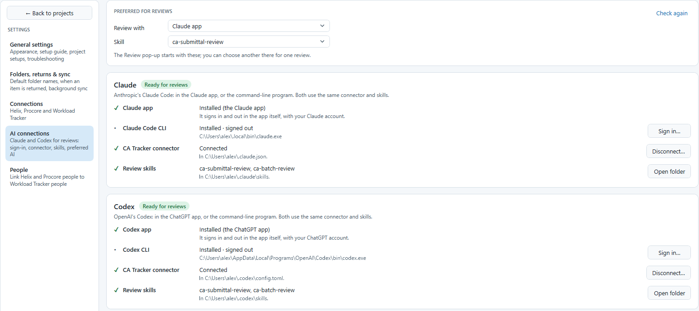

**Review a submittal:**

1. **Download** the submittal's files first. The **Review** button appears on Submittal rows once an AI
   is connected, and works once the submittal has a folder.
2. Click **Review** (beside Download; it's also on the right-click menu and in the item details).
3. Pick the **Files to review** (the newest round starts checked), **Review with**, the **Skill** and
   the **Workflow** ("Let the skill choose" is fine), add any **Notes**, and click **Start review**.
   Notes are where you tell it what it can't work out, for example:
   - "Use the panel schedules on E-601 from the 2026-10-15 IFC set. Check the AIC ratings against the
     short-circuit study."
   - "This is a resubmittal; check only that our R0 comments were addressed."
   - "Focus on the hanger spacing; the product data was approved last round."

   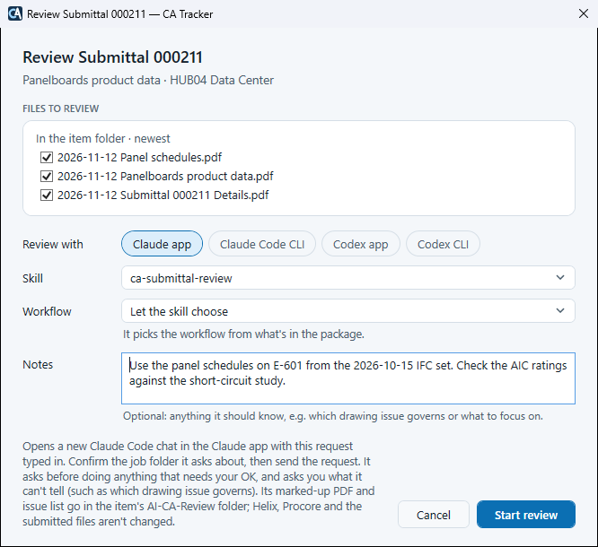

4. Claude or Codex opens with the request typed in.
   - **An app:** press send. The Claude app asks you to confirm the job folder, and the connector asks
     permission the first time it's used.
   - **A command-line version** opens in its own window and starts at once.

   Answer its questions and approve what it asks to do.
5. When it's finished, the row shows a green **AI reviewed** pill before the title (Submittal 000210 in
   the picture under section 4): click it to open the marked-up PDF. The item details have **Open
   marked-up PDF**, **Open issue list** and **Open review folder**. If a newer round comes in later,
   the pill turns grey and names the round that was reviewed ("AI reviewed R1").

What a finished review leaves in the submittal's folder:

```text
Submittals\Elec\000210 - Switchgear shop drawings
├── 2026-11-03 Switchgear shop drawings.pdf        ← what the contractor sent, untouched
└── AI-CA-Review
    ├── AI-CA-Review_000210_Marked-Up.pdf          ← the submittal with clouds and callouts
    ├── AI-CA-Review_000210.docx                   ← the issue list, editable in Word
    └── AI-CA-Review_000210.pdf                    ← the same issue list as a PDF
```

Claude and Codex send what they read to Anthropic or OpenAI under your own account there; CA Tracker
itself sends nothing.

**Connecting by hand** (if you'd rather use a terminal):

```powershell
claude mcp add --scope user ca-tracker -- "$env:LOCALAPPDATA\Programs\SMC CA Tracker\SmcCaTracker.Mcp.exe"
codex mcp add ca-tracker -- "$env:LOCALAPPDATA\Programs\SMC CA Tracker\SmcCaTracker.Mcp.exe"
```

Then ask in Claude Code or Codex, for example:

- "Review the Submittal I just downloaded."
- "Review HUB04 submittal 211 against the specs and the latest IFC drawings."
- "Batch review HUB04 submittals 210, 211 and 217."

### 7. Workload Tracker (optional)

Only if your company runs Workload Tracker:

1. **Settings → Connections → Workload Tracker:** enter its **Address**, click **Sign in to Workload
   Tracker**, sign in in the window that opens and click **Connect CA Tracker** on its Profile page.
2. In each project's **Project settings → Company & team → Workload Tracker**, click **Choose…** to pick
   its tracker project, then under **Team in Workload Tracker** link each person to who they are in
   Helix or Procore (**Confirm**).
3. **Settings → People** links the rest of the Helix and Procore people you see to Workload Tracker
   people.

After that, **Assign to…** (right-click an item) assigns it to someone on the team, and **My work**
also lists items assigned to you. While connected, project setups are shared with everyone on the
project automatically.

### 8. Other settings worth a look

- **Settings → Folders, returns & sync:** the folder names CA Tracker looks for inside each CA folder
  (`RFIs`, `Submittals`, `~Returned` by default), when an item counts as returned, and the background
  sync schedule. Click **Save** when done.
- **Settings → General settings:** appearance (Match Windows, Light or Dark), **Take the tour**, and
  **Open the log folder** if something goes wrong.
- **Settings → Connections:** **Sign out of Helix and Procore…** keeps your saved passwords; **Sign out
  and forget saved passwords…** deletes them too.
